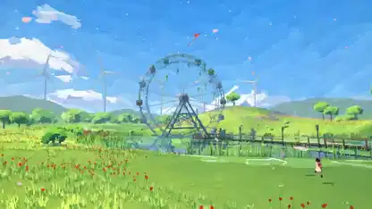

<!-- Generated by scripts/build.py. -->

# Una noria bajo cielos pintados

[Volver a la colección](https://github.com/VibeClip/awesome-fable-5-2-videos/blob/main/README.es.md)

**[▶ Ver vídeo](https://video.twimg.com/amplify_video/2122052717719781376/vid/avc1/1920x1080/qdj_kDvq0lZGWjFR.mp4?tag=29)** · [Publicación original](https://x.com/LexnLin/status/2122056542778535977)

[LexnLin](https://x.com/LexnLin) · 0:40 · 2026-11-15

El autor atribuye la pieza a Claude Fable 5.2. La publicación deja sin especificar el renderizador y los recursos.

## Prompt compartido

No hay un prompt público registrado.

Fuentes y comprobaciones

- Evidencia del modelo: El modelo se menciona en la publicación original
- Accesibilidad de la publicación comprobada: 2026-11-16 — Publicación accesible

Comprobar el acceso a una publicación no equivale a reproducir su generación. La generación y el renderizado no se reprodujeron de forma independiente.

[Licencia y derechos del contenido](https://github.com/VibeClip/awesome-fable-5-2-videos/blob/main/docs/MEDIA-RIGHTS.md)

