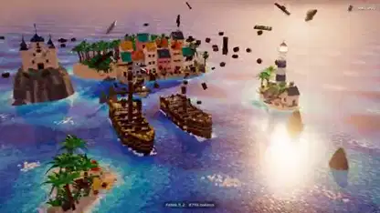

<!-- Generated by scripts/build.py. -->

# Un corto de piratas con olas hechas de bloques

[Volver a la colección](https://github.com/VibeClip/awesome-fable-5-2-videos/blob/main/README.es.md)

**[▶ Ver vídeo](https://video.twimg.com/amplify_video/2121066008483913728/vid/avc1/1920x1080/kzRTU-ZlEwqnem5b.mp4?tag=29)** · [Publicación original](https://x.com/loktar00/status/2121066943662743624)

[loktar00](https://x.com/loktar00) · 0:50 · 2026-11-13

El autor atribuye la escena animada de piratas a Fable 5.2 y explica que cada ola está formada por piezas que se mueven individualmente.

## Prompt compartido

No hay un prompt público registrado.

Fuentes y comprobaciones

- Evidencia del modelo: El modelo se menciona en la publicación original
- Accesibilidad de la publicación comprobada: 2026-11-13 — Publicación accesible

Comprobar el acceso a una publicación no equivale a reproducir su generación. La generación y el renderizado no se reprodujeron de forma independiente.

[Licencia y derechos del contenido](https://github.com/VibeClip/awesome-fable-5-2-videos/blob/main/docs/MEDIA-RIGHTS.md)

