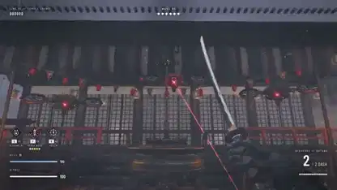

<!-- Generated by scripts/build.py. -->

# Un juego de acción en el navegador ambientado en un valle de cerezos

[Volver a la colección](https://github.com/VibeClip/awesome-fable-5-2-videos/blob/main/README.es.md)

**[▶ Ver vídeo](https://video.twimg.com/amplify_video/2121119476183949312/vid/avc1/3840x2160/1B5Se8KJ2Uf3V53F.mp4?tag=29)** · [Publicación original](https://x.com/MengTo/status/2121139143615074501)

[MengTo](https://x.com/MengTo) · 0:52 · 2026-11-13

El autor usó Fable 5.2 y Three.js sobre una escena propia ya existente. El vídeo recorre en primera persona estructuras iluminadas con faroles, caminos y torres al fondo.

## Prompt compartido

No hay un prompt público registrado.

Fuentes y comprobaciones

- Evidencia del modelo: El modelo se menciona en la publicación original
- Accesibilidad de la publicación comprobada: 2026-11-15 — Publicación accesible

Comprobar el acceso a una publicación no equivale a reproducir su generación. La generación y el renderizado no se reprodujeron de forma independiente.

[Licencia y derechos del contenido](https://github.com/VibeClip/awesome-fable-5-2-videos/blob/main/docs/MEDIA-RIGHTS.md)

