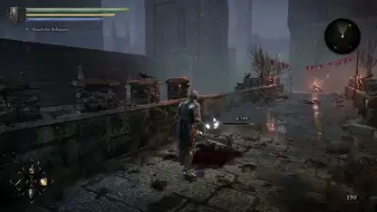

<!-- Generated by scripts/build.py. -->

# Un juego de fantasía oscura en el navegador con Three.js

[Volver a la colección](https://github.com/VibeClip/awesome-fable-5-2-videos/blob/main/README.es.md)

**[▶ Ver vídeo](https://video.twimg.com/ext_tw_video/2121896455816548352/pu/vid/avc1/1280x720/RU6LuiJL3vKv0LKs.mp4?tag=12)** · [Publicación original](https://x.com/MengTo/status/2121896633848017145)

[MengTo](https://x.com/MengTo) · 1:39 · 2026-11-15

El autor indica que usó Fable 5.2 y Opus 5.5 en Claude Code, además de Seedream 5.0 Pro y Tripo para los recursos. La grabación muestra un mapa, escenarios y un encuentro con un jefe.

[Publicación original](https://x.com/MengTo/status/2121896684653576574)

## Prompt compartido

El creador compartió un prompt en el enlace siguiente. Consulta el contexto original, sus referencias y las instrucciones posteriores.

[Leer el prompt del creador](https://x.com/MengTo/status/2121896842300686560)

Fuentes y comprobaciones

- Evidencia del modelo: El modelo se menciona en la publicación original
- Accesibilidad de la publicación comprobada: 2026-11-15 — Publicación accesible

Comprobar el acceso a una publicación no equivale a reproducir su generación. La generación y el renderizado no se reprodujeron de forma independiente.

[Licencia y derechos del contenido](https://github.com/VibeClip/awesome-fable-5-2-videos/blob/main/docs/MEDIA-RIGHTS.md)

