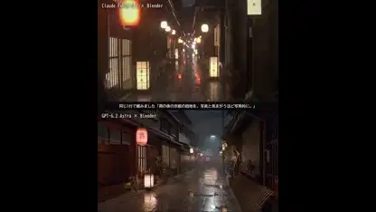

<!-- Generated by scripts/build.py. -->

# Un callejón lluvioso de Kioto en Blender

[Volver a la colección](https://github.com/VibeClip/awesome-fable-5-2-videos/blob/main/README.es.md)

**[▶ Ver vídeo](https://video.twimg.com/amplify_video/2123403402856353792/vid/avc1/480x562/eBUiSAw1Wp3mANi0.mp4?tag=29)** · [Publicación original](https://x.com/mizugame_22/status/2123403431167844544)

[mizugame_22](https://x.com/mizugame_22) · 0:13 · 2026-11-19

Fable 5.2 aparece arriba y GPT-6.2 Astra abajo. Ambos usaron Blender Cycles, recursos externos CC0 y revisión de otra IA. El vídeo original apila los primeros 13 segundos.

## Prompt compartido

Texto original compartido por el creador. Consulta la fuente para conocer el contexto y los materiales necesarios.

> 雨の夜の京都の路地を、写真と見まがうほど写実的に。

[Leer el prompt del creador](https://x.com/mizugame_22/status/2123403431167844544)

Fuentes y comprobaciones

- Evidencia del modelo: El modelo se menciona en la publicación original
- Accesibilidad de la publicación comprobada: 2026-11-24 — Publicación accesible

Comprobar el acceso a una publicación no equivale a reproducir su generación. La generación y el renderizado no se reprodujeron de forma independiente.

[Licencia y derechos del contenido](https://github.com/VibeClip/awesome-fable-5-2-videos/blob/main/docs/MEDIA-RIGHTS.md)

