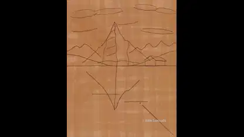

<!-- Generated by scripts/build.py. -->

# Un lago suizo pintado del boceto al reflejo

[Volver a la colección](https://github.com/VibeClip/awesome-fable-5-2-videos/blob/main/README.es.md)

**[▶ Ver vídeo](https://video.twimg.com/amplify_video/2120473115025088512/vid/avc1/1080x1350/smQxijj1Yis_3zAa.mp4?tag=29)** · [Publicación original](https://x.com/MrTacticalX/status/2120473175158849884)

[MrTacticalX](https://x.com/MrTacticalX) · 1:00 · 2026-11-11

El autor atribuye a Fable 5.2 la pintura al óleo de un lago suizo. La publicación no precisa las herramientas de renderizado.

## Prompt compartido

No hay un prompt público registrado.

Fuentes y comprobaciones

- Evidencia del modelo: El modelo se menciona en la publicación original
- Accesibilidad de la publicación comprobada: 2026-11-13 — Publicación accesible

Comprobar el acceso a una publicación no equivale a reproducir su generación. La generación y el renderizado no se reprodujeron de forma independiente.

[Licencia y derechos del contenido](https://github.com/VibeClip/awesome-fable-5-2-videos/blob/main/docs/MEDIA-RIGHTS.md)

