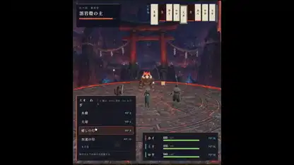

<!-- Generated by scripts/build.py. -->

# Un combate por turnos en el navegador con el orden visible

[Volver a la colección](https://github.com/VibeClip/awesome-fable-5-2-videos/blob/main/README.es.md)

**[▶ Ver vídeo](https://video.twimg.com/amplify_video/2120850004445470720/vid/avc1/1492x1660/RnGC-9muW2GDFzf5.mp4?tag=29)** · [Publicación original](https://x.com/nesaivideo/status/2120851458421821675)

[nesaivideo](https://x.com/nesaivideo) · 3:13 · 2026-11-12

El autor atribuye a Fable 5.2 la demo de navegador, con cuatro personajes 3D, una arena y un orden de turnos visible. La grabación mantiene la interfaz a la vista durante el combate.

## Prompt compartido

No hay un prompt público registrado.

Fuentes y comprobaciones

- Evidencia del modelo: El modelo se menciona en la publicación original
- Accesibilidad de la publicación comprobada: 2026-11-15 — Publicación accesible

Comprobar el acceso a una publicación no equivale a reproducir su generación. La generación y el renderizado no se reprodujeron de forma independiente.

[Licencia y derechos del contenido](https://github.com/VibeClip/awesome-fable-5-2-videos/blob/main/docs/MEDIA-RIGHTS.md)

