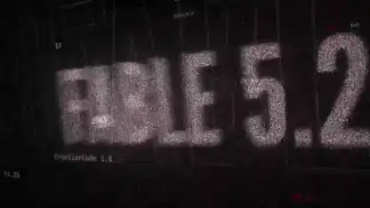

<!-- Generated by scripts/build.py. -->

# Una presentación de Fable con gráficos en rojo y negro

[Volver a la colección](https://github.com/VibeClip/awesome-fable-5-2-videos/blob/main/README.es.md)

**[▶ Ver vídeo](https://video.twimg.com/amplify_video/2120094895734222848/vid/avc1/1920x1080/iPkDdsxiXoDx45PI.mp4?tag=29)** · [Publicación original](https://x.com/noel_ai_lab/status/2120095087397151229)

[noel_ai_lab](https://x.com/noel_ai_lab) · 0:43 · 2026-11-10

El autor dice que Fable 5.2 creó las imágenes con código y usó Suno mediante MCP para la música. La pieza combina cartelas, semitonos y tipografía japonesa en negrita.

## Prompt compartido

No hay un prompt público registrado.

Fuentes y comprobaciones

- Evidencia del modelo: El modelo se menciona en la publicación original
- Accesibilidad de la publicación comprobada: 2026-11-15 — Publicación accesible

Comprobar el acceso a una publicación no equivale a reproducir su generación. La generación y el renderizado no se reprodujeron de forma independiente.

[Licencia y derechos del contenido](https://github.com/VibeClip/awesome-fable-5-2-videos/blob/main/docs/MEDIA-RIGHTS.md)

