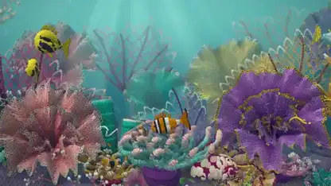

<!-- Generated by scripts/build.py. -->

# Un arrecife de coral con textura de ganchillo

[Volver a la colección](https://github.com/VibeClip/awesome-fable-5-2-videos/blob/main/README.es.md)

**[▶ Ver vídeo](https://video.twimg.com/amplify_video/2120125545249640448/vid/avc1/3840x2160/u-PUTSTEjUibRIGV.mp4?tag=29)** · [Publicación original](https://x.com/petergostev/status/2120125927086600681)

[petergostev](https://x.com/petergostev) · 0:40 · 2026-11-10

El autor identifica el arrecife de estilo ganchillo como un resultado de Fable 5.2.

## Prompt compartido

No hay un prompt público registrado.

Fuentes y comprobaciones

- Evidencia del modelo: El modelo se menciona en la publicación original
- Accesibilidad de la publicación comprobada: 2026-11-13 — Publicación accesible

Comprobar el acceso a una publicación no equivale a reproducir su generación. La generación y el renderizado no se reprodujeron de forma independiente.

[Licencia y derechos del contenido](https://github.com/VibeClip/awesome-fable-5-2-videos/blob/main/docs/MEDIA-RIGHTS.md)

