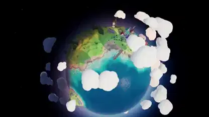

<!-- Generated by scripts/build.py. -->

# Un paseo por un planeta diminuto

[Volver a la colección](https://github.com/VibeClip/awesome-fable-5-2-videos/blob/main/README.es.md)

**[▶ Ver vídeo](https://video.twimg.com/amplify_video/2120187200919027712/vid/avc1/1920x1080/6x9gOegXbLLMQegl.mp4?tag=29)** · [Publicación original](https://x.com/prasenx/status/2120188077855613174)

[prasenx](https://x.com/prasenx) · 0:39 · 2026-11-10

El autor atribuye a Fable 5.2 tanto el planeta interactivo como su tráiler. El motor de renderizado queda sin especificar.

## Prompt compartido

No hay un prompt público registrado.

Fuentes y comprobaciones

- Evidencia del modelo: El modelo se menciona en la publicación original
- Accesibilidad de la publicación comprobada: 2026-11-16 — Publicación accesible

Comprobar el acceso a una publicación no equivale a reproducir su generación. La generación y el renderizado no se reprodujeron de forma independiente.

[Licencia y derechos del contenido](https://github.com/VibeClip/awesome-fable-5-2-videos/blob/main/docs/MEDIA-RIGHTS.md)

