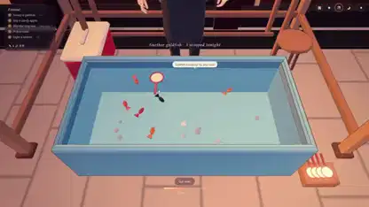

<!-- Generated by scripts/build.py. -->

# Un festival de verano junto al mar

[Volver a la colección](https://github.com/VibeClip/awesome-fable-5-2-videos/blob/main/README.es.md)

**[▶ Ver vídeo](https://video.twimg.com/amplify_video/2121961618372526080/vid/avc1/1920x1080/k__4PGRdruFgIuDd.mp4?tag=29)** · [Publicación original](https://x.com/prasenx/status/2121961933540917658)

[prasenx](https://x.com/prasenx) · 1:36 · 2026-11-15

El autor atribuye el juego a Fable 5.2 y Opus 5.5. El proyecto enlazado describe el uso de Three.js sobre WebGPU.

[Publicación original](https://x.com/prasenx/status/2122020023254618368)

## Prompt compartido

El creador compartió un prompt en el enlace siguiente. Consulta el contexto original, sus referencias y las instrucciones posteriores.

[Leer el prompt del creador](https://x.com/prasenx/status/2122020023254618368)

Fuentes y comprobaciones

- Evidencia del modelo: El modelo se menciona en la publicación original
- Accesibilidad de la publicación comprobada: 2026-11-16 — Publicación accesible

Comprobar el acceso a una publicación no equivale a reproducir su generación. La generación y el renderizado no se reprodujeron de forma independiente.

[Licencia y derechos del contenido](https://github.com/VibeClip/awesome-fable-5-2-videos/blob/main/docs/MEDIA-RIGHTS.md)

