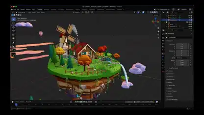

<!-- Generated by scripts/build.py. -->

# Una isla flotante construida en Blender

[Volver a la colección](https://github.com/VibeClip/awesome-fable-5-2-videos/blob/main/README.es.md)

**[▶ Ver vídeo](https://video.twimg.com/amplify_video/2120498596738904064/vid/avc1/1920x984/gIo26aM7PmpiuAib.mp4?tag=29)** · [Publicación original](https://x.com/rewind02/status/2120498751773057186)

[rewind02](https://x.com/rewind02) · 0:30 · 2026-11-11

Según el autor, Fable 5.2 generó objetos, materiales y luces en Python mediante Blender MCP. El autor comparó dos niveles de esfuerzo.

## Prompt compartido

Texto original compartido por el creador. Consulta la fuente para conocer el contexto y los materiales necesarios.

> create a low poly floating island scene in blender using blender mcp

[Leer el prompt del creador](https://x.com/rewind02/status/2120498751773057186)

Fuentes y comprobaciones

- Evidencia del modelo: El modelo se menciona en la publicación original
- Accesibilidad de la publicación comprobada: 2026-11-16 — Publicación accesible

Comprobar el acceso a una publicación no equivale a reproducir su generación. La generación y el renderizado no se reprodujeron de forma independiente.

[Licencia y derechos del contenido](https://github.com/VibeClip/awesome-fable-5-2-videos/blob/main/docs/MEDIA-RIGHTS.md)

