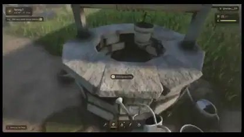

<!-- Generated by scripts/build.py. -->

# Un juego de granja en un solo HTML con clima cambiante

[Volver a la colección](https://github.com/VibeClip/awesome-fable-5-2-videos/blob/main/README.es.md)

**[▶ Ver vídeo](https://video.twimg.com/amplify_video/2120582673261318144/vid/avc1/1920x1010/Oy1nF66fVaGSdKpJ.mp4?tag=29)** · [Publicación original](https://x.com/rewind02/status/2120582812793475290)

[rewind02](https://x.com/rewind02) · 2:04 · 2026-11-11

El autor atribuye el juego a Fable 5.2 y Three.js. La grabación muestra herramientas y terreno con luz diurna, niebla y de noche, con escenarios y texturas generados mediante código.

## Prompt compartido

No hay un prompt público registrado.

Fuentes y comprobaciones

- Evidencia del modelo: El modelo se menciona en la publicación original
- Accesibilidad de la publicación comprobada: 2026-11-15 — Publicación accesible

Comprobar el acceso a una publicación no equivale a reproducir su generación. La generación y el renderizado no se reprodujeron de forma independiente.

[Licencia y derechos del contenido](https://github.com/VibeClip/awesome-fable-5-2-videos/blob/main/docs/MEDIA-RIGHTS.md)

