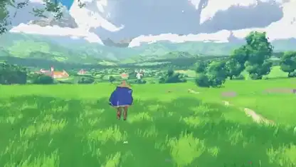

<!-- Generated by scripts/build.py. -->

# Un valle pintado recorrido por un viajero

[Volver a la colección](https://github.com/VibeClip/awesome-fable-5-2-videos/blob/main/README.es.md)

**[▶ Ver vídeo](https://video.twimg.com/amplify_video/2121215994832068608/vid/avc1/1920x1080/Si-UOwjUQwtBMraT.mp4?tag=29)** · [Publicación original](https://x.com/rewind02/status/2121216070375612527)

[rewind02](https://x.com/rewind02) · 0:23 · 2026-11-13

El autor usó Fable 5.2, Three.js y Rapier para el recorrido. El terreno parte de un mapa de alturas y el personaje se creó y animó en Blender.

## Prompt compartido

No hay un prompt público registrado.

Fuentes y comprobaciones

- Evidencia del modelo: El modelo se menciona en la publicación original
- Accesibilidad de la publicación comprobada: 2026-11-15 — Publicación accesible

Comprobar el acceso a una publicación no equivale a reproducir su generación. La generación y el renderizado no se reprodujeron de forma independiente.

[Licencia y derechos del contenido](https://github.com/VibeClip/awesome-fable-5-2-videos/blob/main/docs/MEDIA-RIGHTS.md)

