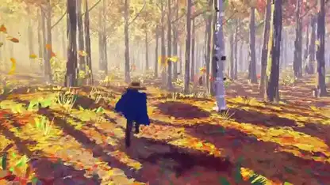

<!-- Generated by scripts/build.py. -->

# Un bosque transitable dibujado con pinceladas al óleo

[Volver a la colección](https://github.com/VibeClip/awesome-fable-5-2-videos/blob/main/README.es.md)

**[▶ Ver vídeo](https://video.twimg.com/amplify_video/2121575069314875392/vid/avc1/1920x1080/gc-SojMEICkZADf-.mp4?tag=29)** · [Publicación original](https://x.com/rewind02/status/2121575140307706285)

[rewind02](https://x.com/rewind02) · 0:16 · 2026-11-14

El autor usó Fable 5.2 y sombreadores GLSL propios en Three.js para dibujar la escena con pinceladas. El personaje y parte de sus movimientos usan recursos existentes.

## Prompt compartido

No hay un prompt público registrado.

Fuentes y comprobaciones

- Evidencia del modelo: El modelo se menciona en la publicación original
- Accesibilidad de la publicación comprobada: 2026-11-15 — Publicación accesible

Comprobar el acceso a una publicación no equivale a reproducir su generación. La generación y el renderizado no se reprodujeron de forma independiente.

[Licencia y derechos del contenido](https://github.com/VibeClip/awesome-fable-5-2-videos/blob/main/docs/MEDIA-RIGHTS.md)

