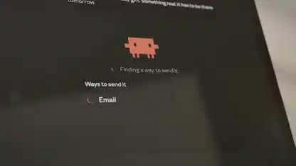

<!-- Generated by scripts/build.py. -->

# La fábula de Clawd

[Volver a la colección](https://github.com/VibeClip/awesome-fable-5-2-videos/blob/main/README.es.md)

**[▶ Ver vídeo](https://video.twimg.com/amplify_video/2121634141472997376/vid/avc1/3840x2160/ad8dwsaeRrRDLc6w.mp4?tag=29)** · [Publicación original](https://x.com/rileybrown/status/2121642720045261185)

[rileybrown](https://x.com/rileybrown) · 2:19 · 2026-11-14

El autor dice que Fable 5.2 escribió Python para construir y animar los escenarios y personajes en Blender. Clawd, Pip y un camión de juguete recorren un estudio, un taller y exteriores.

[Publicación original](https://x.com/rileybrown/status/2121643018117841275)

## Prompt compartido

No hay un prompt público registrado.

Fuentes y comprobaciones

- Evidencia del modelo: El modelo se menciona en la publicación original
- Accesibilidad de la publicación comprobada: 2026-11-15 — Publicación accesible

Comprobar el acceso a una publicación no equivale a reproducir su generación. La generación y el renderizado no se reprodujeron de forma independiente.

[Licencia y derechos del contenido](https://github.com/VibeClip/awesome-fable-5-2-videos/blob/main/docs/MEDIA-RIGHTS.md)

