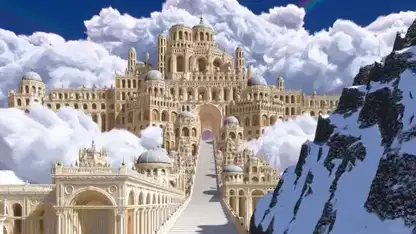

<!-- Generated by scripts/build.py. -->

# Ivory Kingdom, un palacio blanco entre cumbres nevadas

[Volver a la colección](https://github.com/VibeClip/awesome-fable-5-2-videos/blob/main/README.es.md)

**[▶ Ver vídeo](https://video.twimg.com/amplify_video/2121386923503611904/vid/avc1/3840x2160/Xwr5UsmN7kwaB5iI.mp4?tag=29)** · [Publicación original](https://x.com/scottstts/status/2121626206613491787)

[scottstts](https://x.com/scottstts) · 2:00 · 2026-11-14

El autor atribuye a Fable 5.2 una escena de Three.js totalmente procedural. La película pasa de vistas de cumbres y terrazas nevadas a los pasillos del palacio.

[Publicación original](https://x.com/scottstts/status/2121626207334838473)

## Prompt compartido

No hay un prompt público registrado.

Fuentes y comprobaciones

- Evidencia del modelo: El modelo se menciona en la publicación original
- Accesibilidad de la publicación comprobada: 2026-11-14 — Publicación accesible

Comprobar el acceso a una publicación no equivale a reproducir su generación. La generación y el renderizado no se reprodujeron de forma independiente.

[Licencia y derechos del contenido](https://github.com/VibeClip/awesome-fable-5-2-videos/blob/main/docs/MEDIA-RIGHTS.md)

