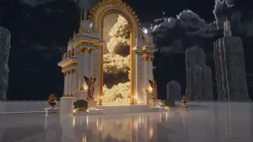

<!-- Generated by scripts/build.py. -->

# El umbral del cielo

[Volver a la colección](https://github.com/VibeClip/awesome-fable-5-2-videos/blob/main/README.es.md)

**[▶ Ver vídeo](https://video.twimg.com/amplify_video/2121888580725325824/vid/avc1/3840x2160/m4Q_EVAAdEgVlKjR.mp4?tag=29)** · [Publicación original](https://x.com/scottstts/status/2121997403284774933)

[scottstts](https://x.com/scottstts) · 2:00 · 2026-11-15

El autor creó este entorno 3D con Fable 5.2 y Three.js y compartió una versión HDR en una respuesta.

[Publicación original](https://x.com/scottstts/status/2121997403595129298)

## Prompt compartido

No hay un prompt público registrado.

Fuentes y comprobaciones

- Evidencia del modelo: El modelo se menciona en la publicación original
- Accesibilidad de la publicación comprobada: 2026-11-16 — Publicación accesible

Comprobar el acceso a una publicación no equivale a reproducir su generación. La generación y el renderizado no se reprodujeron de forma independiente.

[Licencia y derechos del contenido](https://github.com/VibeClip/awesome-fable-5-2-videos/blob/main/docs/MEDIA-RIGHTS.md)

