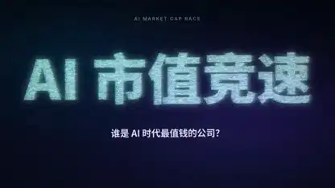

<!-- Generated by scripts/build.py. -->

# Una carrera de capitalización bursátil animada con partículas

[Volver a la colección](https://github.com/VibeClip/awesome-fable-5-2-videos/blob/main/README.es.md)

**[▶ Ver vídeo](https://video.twimg.com/amplify_video/2120163849806462976/vid/avc1/1920x1080/OMSIT8xlrky2bCi_.mp4?tag=29)** · [Publicación original](https://x.com/Stargridcompass/status/2120313054936133751)

[Stargridcompass](https://x.com/Stargridcompass) · 1:00 · 2026-11-11

El autor atribuye a Fable 5.2 la búsqueda de datos, el código de la animación y la síntesis de la música. Los datos proceden del autor.

## Prompt compartido

No hay un prompt público registrado.

Fuentes y comprobaciones

- Evidencia del modelo: El modelo se menciona en la publicación original
- Accesibilidad de la publicación comprobada: 2026-11-12 — Publicación accesible

Comprobar el acceso a una publicación no equivale a reproducir su generación. La generación y el renderizado no se reprodujeron de forma independiente.

[Licencia y derechos del contenido](https://github.com/VibeClip/awesome-fable-5-2-videos/blob/main/docs/MEDIA-RIGHTS.md)

