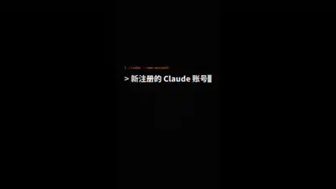

<!-- Generated by scripts/build.py. -->

# Un diario de 28 días animado a partir de capturas

[Volver a la colección](https://github.com/VibeClip/awesome-fable-5-2-videos/blob/main/README.es.md)

**[▶ Ver vídeo](https://video.twimg.com/amplify_video/2121618501471219712/vid/avc1/1080x1920/Gk64QZEmZQz7NdJ0.mp4?tag=29)** · [Publicación original](https://x.com/Stargridcompass/status/2121770161057247242)

[Stargridcompass](https://x.com/Stargridcompass) · 0:28 · 2026-11-15

El autor entregó a Fable 5.2 las capturas de 27 días previos para cerrar una serie de 28 días. El montaje enlaza las capturas con un contador de días.

## Prompt compartido

No hay un prompt público registrado.

Fuentes y comprobaciones

- Evidencia del modelo: El modelo se menciona en la publicación original
- Accesibilidad de la publicación comprobada: 2026-11-15 — Publicación accesible

Comprobar el acceso a una publicación no equivale a reproducir su generación. La generación y el renderizado no se reprodujeron de forma independiente.

[Licencia y derechos del contenido](https://github.com/VibeClip/awesome-fable-5-2-videos/blob/main/docs/MEDIA-RIGHTS.md)

