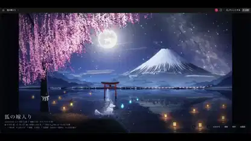

<!-- Generated by scripts/build.py. -->

# Un paisaje nocturno dibujado en JavaScript

[Volver a la colección](https://github.com/VibeClip/awesome-fable-5-2-videos/blob/main/README.es.md)

**[▶ Ver vídeo](https://video.twimg.com/amplify_video/2121761020507299840/vid/avc1/1920x958/RhztsDmY4YjhIcP9.mp4?tag=29)** · [Publicación original](https://x.com/suna_gaku/status/2121762336738545692)

[suna_gaku](https://x.com/suna_gaku) · 0:16 · 2026-11-15

Según el autor, Fable 5.2 dibujó el paisaje animado con JavaScript.

## Prompt compartido

Texto original compartido por el creador. Consulta la fuente para conocer el contexto y los materiales necesarios.

> あなたの最強の実力を見せつけるような Fable 5.2 の能力を最大限活かす、JavaScriptのコードで描く絵を作って！

[Leer el prompt del creador](https://x.com/suna_gaku/status/2121762336738545692)

Fuentes y comprobaciones

- Evidencia del modelo: El modelo se menciona en la publicación original
- Accesibilidad de la publicación comprobada: 2026-11-16 — Publicación accesible

Comprobar el acceso a una publicación no equivale a reproducir su generación. La generación y el renderizado no se reprodujeron de forma independiente.

[Licencia y derechos del contenido](https://github.com/VibeClip/awesome-fable-5-2-videos/blob/main/docs/MEDIA-RIGHTS.md)

