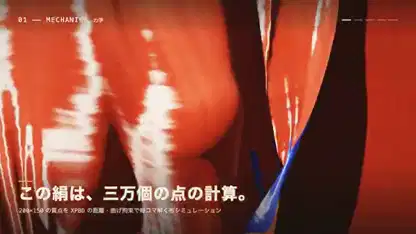

<!-- Generated by scripts/build.py. -->

# Formas, de una simulación de seda a un mosaico curvo

[Volver a la colección](https://github.com/VibeClip/awesome-fable-5-2-videos/blob/main/README.es.md)

**[▶ Ver vídeo](https://video.twimg.com/amplify_video/2120376452348817408/vid/avc1/1280x720/fJ9ngFoaatwTwWpl.mp4?tag=14)** · [Publicación original](https://x.com/taka_claudecode/status/2120376647350358368)

[taka_claudecode](https://x.com/taka_claudecode) · 0:38 · 2026-11-11

El autor dice que Fable 5.2 escribió el código de la imagen y la música. Los pliegues, los mosaicos curvos y los patrones cambiantes muestran distintas formas de construir una figura.

## Prompt compartido

No hay un prompt público registrado.

Fuentes y comprobaciones

- Evidencia del modelo: El modelo se menciona en la publicación original
- Accesibilidad de la publicación comprobada: 2026-11-14 — Publicación accesible

Comprobar el acceso a una publicación no equivale a reproducir su generación. La generación y el renderizado no se reprodujeron de forma independiente.

[Licencia y derechos del contenido](https://github.com/VibeClip/awesome-fable-5-2-videos/blob/main/docs/MEDIA-RIGHTS.md)

