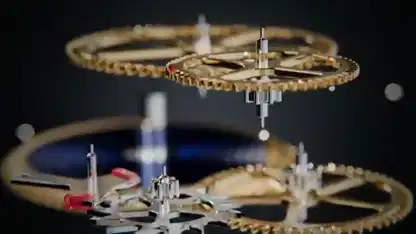

<!-- Generated by scripts/build.py. -->

# Vista explosionada del mecanismo de un reloj

[Volver a la colección](https://github.com/VibeClip/awesome-fable-5-2-videos/blob/main/README.es.md)

**[▶ Ver vídeo](https://video.twimg.com/amplify_video/2119911154638376960/vid/avc1/1920x1080/W-EtG3d_QCeqJjGK.mp4?tag=29)** · [Publicación original](https://x.com/techfren/status/2119911343633682916)

[techfren](https://x.com/techfren) · 0:42 · 2026-11-09

El autor dice que Fable 5.2 construyó el mecanismo con código. Los engranajes y las placas se separan en capas antes de volver al reloj montado. La publicación no indica la herramienta de renderizado.

## Prompt compartido

No hay un prompt público registrado.

Fuentes y comprobaciones

- Evidencia del modelo: El modelo se menciona en la publicación original
- Accesibilidad de la publicación comprobada: 2026-11-14 — Publicación accesible

Comprobar el acceso a una publicación no equivale a reproducir su generación. La generación y el renderizado no se reprodujeron de forma independiente.

[Licencia y derechos del contenido](https://github.com/VibeClip/awesome-fable-5-2-videos/blob/main/docs/MEDIA-RIGHTS.md)

