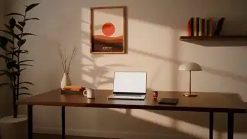

<!-- Generated by scripts/build.py. -->

# Hasta el amanecer, una historia de escritorio renderizada en Blender

[Volver a la colección](https://github.com/VibeClip/awesome-fable-5-2-videos/blob/main/README.es.md)

**[▶ Ver vídeo](https://video.twimg.com/amplify_video/2120640502261575680/vid/avc1/1280x720/k2KorEXRvxHQV80s.mp4?tag=29)** · [Publicación original](https://x.com/toumorocorn_00/status/2120640549543936475)

[toumorocorn_00](https://x.com/toumorocorn_00) · 0:59 · 2026-11-11

El autor se inspiró en The Edge para hacer un corto con su propia mascota y música. Fable 5.2 programó la habitación, la mesa y la figura en Blender. El autor atribuye la música a muse y Suno.

## Prompt compartido

No hay un prompt público registrado.

Fuentes y comprobaciones

- Evidencia del modelo: El modelo se menciona en la publicación original
- Accesibilidad de la publicación comprobada: 2026-11-14 — Publicación accesible

Comprobar el acceso a una publicación no equivale a reproducir su generación. La generación y el renderizado no se reprodujeron de forma independiente.

[Licencia y derechos del contenido](https://github.com/VibeClip/awesome-fable-5-2-videos/blob/main/docs/MEDIA-RIGHTS.md)

