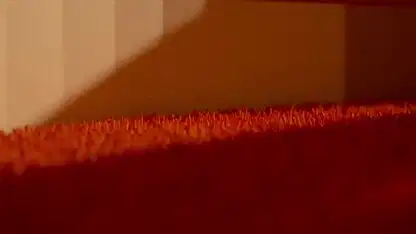

<!-- Generated by scripts/build.py. -->

# Un estudio de interiores con luz ámbar

[Volver a la colección](https://github.com/VibeClip/awesome-fable-5-2-videos/blob/main/README.es.md)

**[▶ Ver vídeo](https://video.twimg.com/amplify_video/2121100838227841024/vid/avc1/1920x1080/XQKlR2Wry89HJEpH.mp4?tag=29)** · [Publicación original](https://x.com/untitled_sys/status/2121106939094741255)

[untitled_sys](https://x.com/untitled_sys) · 0:20 · 2026-11-13

El autor presenta la pieza como un experimento de Fable 5.2. El proceso de renderizado y creación de recursos queda sin especificar.

## Prompt compartido

No hay un prompt público registrado.

Fuentes y comprobaciones

- Evidencia del modelo: El modelo se menciona en la publicación original
- Accesibilidad de la publicación comprobada: 2026-11-16 — Publicación accesible

Comprobar el acceso a una publicación no equivale a reproducir su generación. La generación y el renderizado no se reprodujeron de forma independiente.

[Licencia y derechos del contenido](https://github.com/VibeClip/awesome-fable-5-2-videos/blob/main/docs/MEDIA-RIGHTS.md)

