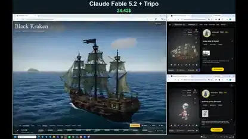

<!-- Generated by scripts/build.py. -->

# Una demo de un velero con controles de mar y clima

[Volver a la colección](https://github.com/VibeClip/awesome-fable-5-2-videos/blob/main/README.es.md)

**[▶ Ver vídeo](https://video.twimg.com/amplify_video/2120189120093757441/vid/avc1/1920x1200/IlWG73RcQBDsxhM4.mp4?tag=29)** · [Publicación original](https://x.com/vib3coded/status/2120189785247498513)

[vib3coded](https://x.com/vib3coded) · 0:18 · 2026-11-10

El autor atribuye la demostración a Fable 5.2 y Tripo.

## Prompt compartido

No hay un prompt público registrado.

Fuentes y comprobaciones

- Evidencia del modelo: El modelo se menciona en la publicación original
- Accesibilidad de la publicación comprobada: 2026-11-13 — Publicación accesible

Comprobar el acceso a una publicación no equivale a reproducir su generación. La generación y el renderizado no se reprodujeron de forma independiente.

[Licencia y derechos del contenido](https://github.com/VibeClip/awesome-fable-5-2-videos/blob/main/docs/MEDIA-RIGHTS.md)

