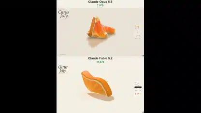

<!-- Generated by scripts/build.py. -->

# Dos modelos crean una gelatina de naranja interactiva

[Volver a la colección](https://github.com/VibeClip/awesome-fable-5-2-videos/blob/main/README.es.md)

**[▶ Ver vídeo](https://video.twimg.com/amplify_video/2121646347770015745/vid/avc1/1080x1400/oYsA5ldV906FI0dm.mp4?tag=29)** · [Publicación original](https://x.com/vib3coded/status/2121646685319221546)

[vib3coded](https://x.com/vib3coded) · 0:17 · 2026-11-14

El autor compara Fable 5.2 y Opus 5.5 con la misma instrucción. La grabación muestra cómo se deforman ambas gelatinas. El prompt público especifica WebGPU y WGSL.

## Prompt compartido

El creador compartió un prompt en el enlace siguiente. Consulta el contexto original, sus referencias y las instrucciones posteriores.

[Leer el prompt del creador](https://x.com/vib3coded/status/2121646834611331214)

Fuentes y comprobaciones

- Evidencia del modelo: El modelo se menciona en la publicación original
- Accesibilidad de la publicación comprobada: 2026-11-14 — Publicación accesible

Comprobar el acceso a una publicación no equivale a reproducir su generación. La generación y el renderizado no se reprodujeron de forma independiente.

[Licencia y derechos del contenido](https://github.com/VibeClip/awesome-fable-5-2-videos/blob/main/docs/MEDIA-RIGHTS.md)

