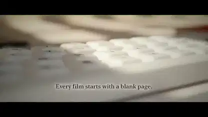

<!-- Generated by scripts/build.py. -->

# Un corto de Blender con un Clawd de escritorio

[Volver a la colección](https://github.com/VibeClip/awesome-fable-5-2-videos/blob/main/README.es.md)

**[▶ Ver vídeo](https://video.twimg.com/amplify_video/2120729437482455040/vid/avc1/1920x1080/6gkPJnL7ykHAwazS.mp4?tag=29)** · [Publicación original](https://x.com/wangray/status/2120730013037466048)

[wangray](https://x.com/wangray) · 0:54 · 2026-11-12

El autor acredita a Fable 5.2 y al renderizado local en Blender, y comparte la instrucción completa en la publicación original.

## Prompt compartido

El creador compartió un prompt en el enlace siguiente. Consulta el contexto original, sus referencias y las instrucciones posteriores.

[Leer el prompt del creador](https://x.com/wangray/status/2120730013037466048)

Fuentes y comprobaciones

- Evidencia del modelo: El modelo se menciona en la publicación original
- Accesibilidad de la publicación comprobada: 2026-11-13 — Publicación accesible

Comprobar el acceso a una publicación no equivale a reproducir su generación. La generación y el renderizado no se reprodujeron de forma independiente.

[Licencia y derechos del contenido](https://github.com/VibeClip/awesome-fable-5-2-videos/blob/main/docs/MEDIA-RIGHTS.md)

