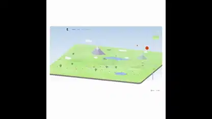

<!-- Generated by scripts/build.py. -->

# La cabecera de un portafolio se convierte en una isla interactiva

[Volver a la colección](https://github.com/VibeClip/awesome-fable-5-2-videos/blob/main/README.es.md)

**[▶ Ver vídeo](https://video.twimg.com/amplify_video/2120683743199301632/vid/avc1/1080x1080/ezd_CzSHH4_ZktKm.mp4?tag=29)** · [Publicación original](https://x.com/willbepan/status/2120683775499575626)

[willbepan](https://x.com/willbepan) · 0:20 · 2026-11-12

El autor atribuye a Fable 5.2 la conversión de la cabecera plana de su portafolio en una isla 3D interactiva. La grabación alterna una vista elevada y otra más cercana del paisaje.

## Prompt compartido

No hay un prompt público registrado.

Fuentes y comprobaciones

- Evidencia del modelo: El modelo se menciona en la publicación original
- Accesibilidad de la publicación comprobada: 2026-11-15 — Publicación accesible

Comprobar el acceso a una publicación no equivale a reproducir su generación. La generación y el renderizado no se reprodujeron de forma independiente.

[Licencia y derechos del contenido](https://github.com/VibeClip/awesome-fable-5-2-videos/blob/main/docs/MEDIA-RIGHTS.md)

