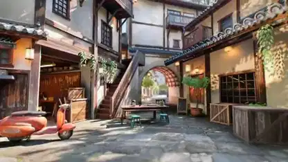

<!-- Generated by scripts/build.py. -->

# Tres interiores ilustrados recorridos en Three.js

[Volver a la colección](https://github.com/VibeClip/awesome-fable-5-2-videos/blob/main/README.es.md)

**[▶ Ver vídeo](https://video.twimg.com/amplify_video/2120947168924364800/vid/avc1/1920x1080/zq1_KKLKIQD1OmZX.mp4?tag=29)** · [Publicación original](https://x.com/XRarchitect/status/2120947265007440052)

[XRarchitect](https://x.com/XRarchitect) · 0:21 · 2026-11-12

El autor identifica Atlas, Fable 5.2 y Three.js. La cámara atraviesa espacios distintos, desde un patio luminoso hasta un interior de luz cálida.

## Prompt compartido

No hay un prompt público registrado.

Fuentes y comprobaciones

- Evidencia del modelo: El modelo se menciona en la publicación original
- Accesibilidad de la publicación comprobada: 2026-11-14 — Publicación accesible

Comprobar el acceso a una publicación no equivale a reproducir su generación. La generación y el renderizado no se reprodujeron de forma independiente.

[Licencia y derechos del contenido](https://github.com/VibeClip/awesome-fable-5-2-videos/blob/main/docs/MEDIA-RIGHTS.md)

