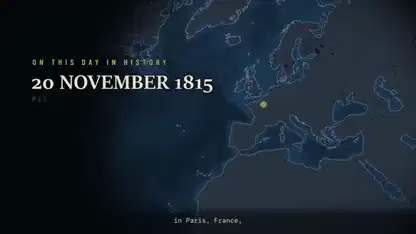

<!-- Generated by scripts/build.py. -->

# 第二次パリ条約

[一覧に戻る](https://github.com/VibeClip/awesome-fable-5-2-videos/blob/main/README.ja.md)

**[▶ 本編](https://video.twimg.com/amplify_video/2121299667233234945/vid/avc1/1920x1080/Fj-__n_Xwic0VA0B.mp4?tag=29)** · [元の投稿](https://x.com/adityavg13/status/2121299920141599107)

[adityavg13](https://x.com/adityavg13) · 1:44 · 2026-11-13

作者はFable 5.2とAfter Effectsで編集し、自らナレーションを担当した。

## 公開プロンプト

公開プロンプトは未登録です。

出典と確認情報

- モデル表記の根拠: 元の投稿にモデル名の記載あり
- 投稿のアクセス確認日: 2026-11-16 — 投稿にアクセス可能

投稿のアクセス確認と動画生成の再現は別です。生成やレンダリングを独立して再現していません。

[ライセンスとメディアの権利](https://github.com/VibeClip/awesome-fable-5-2-videos/blob/main/docs/MEDIA-RIGHTS.md)

