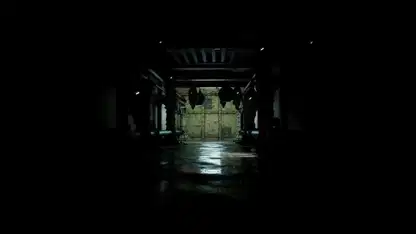

<!-- Generated by scripts/build.py. -->

# ランタンを灯すクモ

[一覧に戻る](https://github.com/VibeClip/awesome-fable-5-2-videos/blob/main/README.ja.md)

**[▶ 本編](https://video.twimg.com/amplify_video/2122065027339329536/vid/avc1/2580x1080/TXi8bpetSDYDKLzz.mp4?tag=29)** · [元の投稿](https://x.com/aGim_asf/status/2122065184743153882)

[aGim_asf](https://x.com/aGim_asf) · 1:03 · 2026-11-15

素材はGPTの画像とTripoを利用。Fable 5.2がBlenderのリグ、カット、動きをスクリプト化した。作者の返信から制作工程、プロンプト、音源のクレジットを確認できる。

[元の投稿](https://x.com/aGim_asf/status/2122065188325122269)

## 公開プロンプト

作者が下記のリンクでプロンプトを公開しています。参考素材や追加指示と合わせて元の文脈を確認してください。

[作者の公開プロンプトを読む](https://x.com/aGim_asf/status/2122065188325122269)

出典と確認情報

- モデル表記の根拠: 元の投稿にモデル名の記載あり
- 投稿のアクセス確認日: 2026-11-16 — 投稿にアクセス可能

投稿のアクセス確認と動画生成の再現は別です。生成やレンダリングを独立して再現していません。

[ライセンスとメディアの権利](https://github.com/VibeClip/awesome-fable-5-2-videos/blob/main/docs/MEDIA-RIGHTS.md)

