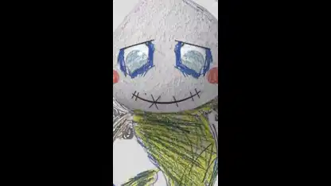

<!-- Generated by scripts/build.py. -->

# 縫われた口

[一覧に戻る](https://github.com/VibeClip/awesome-fable-5-2-videos/blob/main/README.ja.md)

**[▶ 本編](https://video.twimg.com/amplify_video/2122969942878564352/vid/avc1/320x568/6ePWZHP5RN8fjeCS.mp4?tag=29)** · [元の投稿](https://x.com/akiyoshisan/status/2122970728492646854)

[akiyoshisan](https://x.com/akiyoshisan) · 0:42 · 2026-11-18

Fable 5.2がPythonとBlenderで原画を動かし、作者のベース録音をSunoで延長した。

## 公開プロンプト

作者が公開した原文のまま掲載。必要な入力や文脈は元の投稿を参照してください。

> 顔に芝居をさせて！

[作者の公開プロンプトを読む](https://x.com/akiyoshisan/status/2122970728492646854)

出典と確認情報

- モデル表記の根拠: 元の投稿にモデル名の記載あり
- 投稿のアクセス確認日: 2026-11-21 — 投稿にアクセス可能

投稿のアクセス確認と動画生成の再現は別です。生成やレンダリングを独立して再現していません。

[ライセンスとメディアの権利](https://github.com/VibeClip/awesome-fable-5-2-videos/blob/main/docs/MEDIA-RIGHTS.md)

