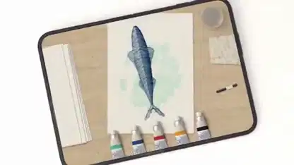

<!-- Generated by scripts/build.py. -->

# 折りたたみ画面向け水彩アプリのデモ

[一覧に戻る](https://github.com/VibeClip/awesome-fable-5-2-videos/blob/main/README.ja.md)

**[▶ 本編](https://video.twimg.com/amplify_video/2120301806248984576/vid/avc1/960x540/SPRHR2g2Wawm3bva.mp4?tag=29)** · [元の投稿](https://x.com/anshuc/status/2120301850532499927)

[anshuc](https://x.com/anshuc) · 1:07 · 2026-11-10

作者はFable 5.2に開閉角度を使うアプリとデモ映像を依頼し、デザインと映像のスキルを指定した。途中で作者自身も修正を加えた。

[元の投稿](https://x.com/anshuc/status/2120301853825024054)

## 公開プロンプト

作者が下記のリンクでプロンプトを公開しています。参考素材や追加指示と合わせて元の文脈を確認してください。

[作者の公開プロンプトを読む](https://x.com/anshuc/status/2120301853825024054)

出典と確認情報

- モデル表記の根拠: 元の投稿にモデル名の記載あり
- 投稿のアクセス確認日: 2026-11-16 — 投稿にアクセス可能

投稿のアクセス確認と動画生成の再現は別です。生成やレンダリングを独立して再現していません。

[ライセンスとメディアの権利](https://github.com/VibeClip/awesome-fable-5-2-videos/blob/main/docs/MEDIA-RIGHTS.md)

