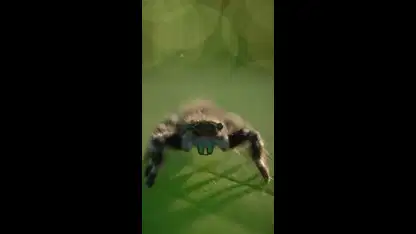

<!-- Generated by scripts/build.py. -->

# 緑の葉にいるクモのマクロ風映像

[一覧に戻る](https://github.com/VibeClip/awesome-fable-5-2-videos/blob/main/README.ja.md)

**[▶ 本編](https://video.twimg.com/amplify_video/2120213743829168128/vid/avc1/1080x1920/rJtx59-X2623RSlg.mp4?tag=29)** · [元の投稿](https://x.com/aollivier82/status/2120290412283703522)

[aollivier82](https://x.com/aollivier82) · 0:15 · 2026-11-10

作者はFable 5.2に写実的なクモの映像を依頼。浅い被写界深度と葉に近い視点でマクロ撮影風に見せています。制作・描画ツールは未公表です。

## 公開プロンプト

公開プロンプトは未登録です。

出典と確認情報

- モデル表記の根拠: 元の投稿にモデル名の記載あり
- 投稿のアクセス確認日: 2026-11-15 — 投稿にアクセス可能

投稿のアクセス確認と動画生成の再現は別です。生成やレンダリングを独立して再現していません。

[ライセンスとメディアの権利](https://github.com/VibeClip/awesome-fable-5-2-videos/blob/main/docs/MEDIA-RIGHTS.md)

