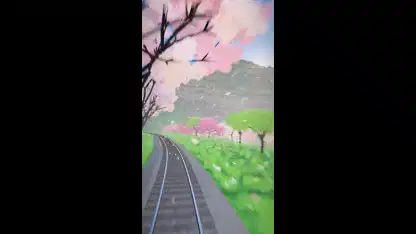

<!-- Generated by scripts/build.py. -->

# 風景が移り変わる静かな鉄道の旅

[一覧に戻る](https://github.com/VibeClip/awesome-fable-5-2-videos/blob/main/README.ja.md)

**[▶ 本編](https://video.twimg.com/amplify_video/2120214618446417920/vid/avc1/1080x1920/jW0o4UtzTEqtErDB.mp4?tag=29)** · [元の投稿](https://x.com/aollivier82/status/2120335703062290623)

[aollivier82](https://x.com/aollivier82) · 0:40 · 2026-11-11

作者はFable 5.2に気持ちが落ち着く映像を依頼。縦画面の中央に線路を保ち、花、夕焼け、雪とオーロラへと風景が変わります。描画ツールは未公表です。

## 公開プロンプト

公開プロンプトは未登録です。

出典と確認情報

- モデル表記の根拠: 元の投稿にモデル名の記載あり
- 投稿のアクセス確認日: 2026-11-15 — 投稿にアクセス可能

投稿のアクセス確認と動画生成の再現は別です。生成やレンダリングを独立して再現していません。

[ライセンスとメディアの権利](https://github.com/VibeClip/awesome-fable-5-2-videos/blob/main/docs/MEDIA-RIGHTS.md)

