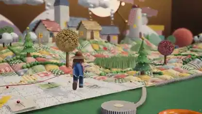

<!-- Generated by scripts/build.py. -->

# ストップモーション風の遊べるパッチワークの村

[一覧に戻る](https://github.com/VibeClip/awesome-fable-5-2-videos/blob/main/README.ja.md)

**[▶ 本編](https://video.twimg.com/amplify_video/2120745677055733760/vid/avc1/2560x1440/3alE49tTHiEZV3hx.mp4?tag=29)** · [元の投稿](https://x.com/BlendiByl/status/2120746541636047347)

[BlendiByl](https://x.com/BlendiByl) · 0:27 · 2026-11-12

作者はFable 5.2で遊べるシーンを作り、マップ全体をコードで制作したと説明しています。

## 公開プロンプト

公開プロンプトは未登録です。

出典と確認情報

- モデル表記の根拠: 元の投稿にモデル名の記載あり
- 投稿のアクセス確認日: 2026-11-14 — 投稿にアクセス可能

投稿のアクセス確認と動画生成の再現は別です。生成やレンダリングを独立して再現していません。

[ライセンスとメディアの権利](https://github.com/VibeClip/awesome-fable-5-2-videos/blob/main/docs/MEDIA-RIGHTS.md)

