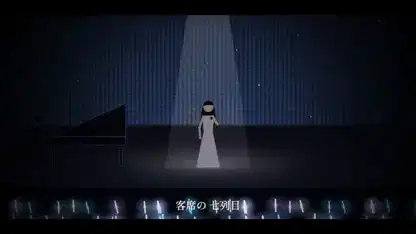

<!-- Generated by scripts/build.py. -->

# 最後のライブ

[一覧に戻る](https://github.com/VibeClip/awesome-fable-5-2-videos/blob/main/README.ja.md)

**[▶ 本編](https://video.twimg.com/amplify_video/2120422211702177792/vid/avc1/1280x720/s1sR2PVkGpwyUSqy.mp4?tag=29)** · [元の投稿](https://x.com/challenger_ND/status/2120423740756664820)

[challenger_ND](https://x.com/challenger_ND) · 3:02 · 2026-11-11

投稿の2本目。Fable 5.2がコードで初稿を作り、作者がSunoで曲を制作し、曲に合わせて映像を調整した。

## 公開プロンプト

作者が公開した原文のまま掲載。必要な入力や文脈は元の投稿を参照してください。

> 全米が泣けるレベルのライブ動画をコードのみで作って

[作者の公開プロンプトを読む](https://x.com/challenger_ND/status/2120423740756664820)

出典と確認情報

- モデル表記の根拠: 元の投稿にモデル名の記載あり
- 投稿のアクセス確認日: 2026-11-16 — 投稿にアクセス可能

投稿のアクセス確認と動画生成の再現は別です。生成やレンダリングを独立して再現していません。

[ライセンスとメディアの権利](https://github.com/VibeClip/awesome-fable-5-2-videos/blob/main/docs/MEDIA-RIGHTS.md)

