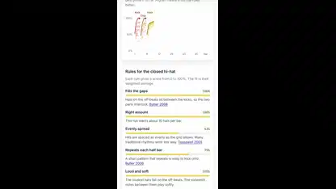

<!-- Generated by scripts/build.py. -->

# 生成したパターンを組み上げたハウス曲

[一覧に戻る](https://github.com/VibeClip/awesome-fable-5-2-videos/blob/main/README.ja.md)

**[▶ 本編](https://video.twimg.com/amplify_video/2120904570314305536/vid/avc1/1206x2266/8g60h4oMlWzSL0mh.mp4?tag=29)** · [元の投稿](https://x.com/deedydas/status/2120905625852936318)

[deedydas](https://x.com/deedydas) · 5:51 · 2026-11-12

作者によると、Fable 5.2が楽器ごとのパターンを試し、選んだものをハウス曲に編成。元の動画では音楽とアレンジ画面を確認できます。

[元の投稿](https://x.com/deedydas/status/2120905629459992996)

## 公開プロンプト

公開プロンプトは未登録です。

出典と確認情報

- モデル表記の根拠: 元の投稿にモデル名の記載あり
- 投稿のアクセス確認日: 2026-11-15 — 投稿にアクセス可能

投稿のアクセス確認と動画生成の再現は別です。生成やレンダリングを独立して再現していません。

[ライセンスとメディアの権利](https://github.com/VibeClip/awesome-fable-5-2-videos/blob/main/docs/MEDIA-RIGHTS.md)

