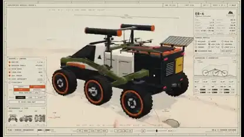

<!-- Generated by scripts/build.py. -->

# 不整地を走るローバーのサスペンションシミュレーター

[一覧に戻る](https://github.com/VibeClip/awesome-fable-5-2-videos/blob/main/README.ja.md)

**[▶ 本編](https://video.twimg.com/amplify_video/2120558575387131905/vid/avc1/3456x1990/D5saQ1Xn1-2_bXLA.mp4?tag=29)** · [元の投稿](https://x.com/DilumSanjaya/status/2120561077385867663)

[DilumSanjaya](https://x.com/DilumSanjaya) · 1:22 · 2026-11-11

作者はFable 5.2にロッカーボギー式の車両を設計させ、荒れた地形で走行をシミュレーション。複数の角度から車輪の動きを見せ、元の投稿に体験版があります。

## 公開プロンプト

公開プロンプトは未登録です。

出典と確認情報

- モデル表記の根拠: 元の投稿にモデル名の記載あり
- 投稿のアクセス確認日: 2026-11-14 — 投稿にアクセス可能

投稿のアクセス確認と動画生成の再現は別です。生成やレンダリングを独立して再現していません。

[ライセンスとメディアの権利](https://github.com/VibeClip/awesome-fable-5-2-videos/blob/main/docs/MEDIA-RIGHTS.md)

