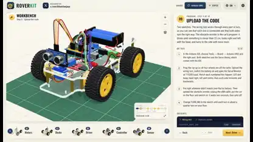

<!-- Generated by scripts/build.py. -->

# 『RoverKit』ロボットの組み立てを体験できるガイド

[一覧に戻る](https://github.com/VibeClip/awesome-fable-5-2-videos/blob/main/README.ja.md)

**[▶ 本編](https://video.twimg.com/amplify_video/2121283445456588800/vid/avc1/3456x1990/uBZhtusJ-gGu4i86.mp4?tag=29)** · [元の投稿](https://x.com/DilumSanjaya/status/2121286147393651085)

[DilumSanjaya](https://x.com/DilumSanjaya) · 1:46 · 2026-11-13

作者はFable 5.2でアプリを制作。3D組み立てガイド、コードの図解、コースを変更できる走行シミュレーターを順に見せています。

[元の投稿](https://x.com/DilumSanjaya/status/2121286149910220854)

## 公開プロンプト

公開プロンプトは未登録です。

出典と確認情報

- モデル表記の根拠: 元の投稿にモデル名の記載あり
- 投稿のアクセス確認日: 2026-11-14 — 投稿にアクセス可能

投稿のアクセス確認と動画生成の再現は別です。生成やレンダリングを独立して再現していません。

[ライセンスとメディアの権利](https://github.com/VibeClip/awesome-fable-5-2-videos/blob/main/docs/MEDIA-RIGHTS.md)

