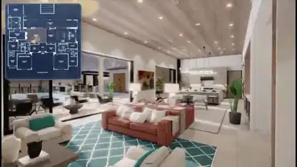

<!-- Generated by scripts/build.py. -->

# 間取り図から家具付き住宅の3D内覧へ

[一覧に戻る](https://github.com/VibeClip/awesome-fable-5-2-videos/blob/main/README.ja.md)

**[▶ 本編](https://video.twimg.com/amplify_video/2120175906501345281/vid/avc1/1902x1080/bf_XglfsEta4QCXA.mp4?tag=16)** · [元の投稿](https://x.com/everestchris6/status/2120175941616128277)

[everestchris6](https://x.com/everestchris6) · 0:10 · 2026-11-10

作者はFable 5.2で図面から3D内覧を作ったと説明。家具のある部屋を移動しながら画面の隅に間取り図を表示しています。

## 公開プロンプト

公開プロンプトは未登録です。

出典と確認情報

- モデル表記の根拠: 元の投稿にモデル名の記載あり
- 投稿のアクセス確認日: 2026-11-15 — 投稿にアクセス可能

投稿のアクセス確認と動画生成の再現は別です。生成やレンダリングを独立して再現していません。

[ライセンスとメディアの権利](https://github.com/VibeClip/awesome-fable-5-2-videos/blob/main/docs/MEDIA-RIGHTS.md)

