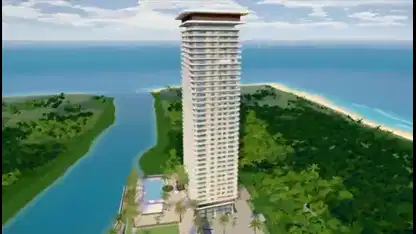

<!-- Generated by scripts/build.py. -->

# Three.jsで高層タワーの外観から室内へ

[一覧に戻る](https://github.com/VibeClip/awesome-fable-5-2-videos/blob/main/README.ja.md)

**[▶ 本編](https://video.twimg.com/amplify_video/2120939561715163137/vid/avc1/1898x1080/jxemZtOQ1szTzU7-.mp4?tag=16)** · [元の投稿](https://x.com/everestchris6/status/2120939600504074444)

[everestchris6](https://x.com/everestchris6) · 0:16 · 2026-11-12

作者は間取り図の内覧にFable 5.2とThree.jsを使用。水辺の高層タワーの外観から、曲面の窓がある室内へ進みます。

## 公開プロンプト

公開プロンプトは未登録です。

出典と確認情報

- モデル表記の根拠: 元の投稿にモデル名の記載あり
- 投稿のアクセス確認日: 2026-11-15 — 投稿にアクセス可能

投稿のアクセス確認と動画生成の再現は別です。生成やレンダリングを独立して再現していません。

[ライセンスとメディアの権利](https://github.com/VibeClip/awesome-fable-5-2-videos/blob/main/docs/MEDIA-RIGHTS.md)

