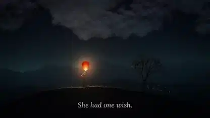

<!-- Generated by scripts/build.py. -->

# 夜に灯る願い

[一覧に戻る](https://github.com/VibeClip/awesome-fable-5-2-videos/blob/main/README.ja.md)

**[▶ 本編](https://video.twimg.com/amplify_video/2121360344727609344/vid/avc1/1280x720/4oNmqpcE1pO7yUPp.mp4?tag=14)** · [元の投稿](https://x.com/GabransKristers/status/2121361595313828070)

[GabransKristers](https://x.com/GabransKristers) · 0:20 · 2026-11-13

作者は物語、コードで描いた映像、音をFable 5.2で制作したと説明している。

## 公開プロンプト

公開プロンプトは未登録です。

出典と確認情報

- モデル表記の根拠: 元の投稿にモデル名の記載あり
- 投稿のアクセス確認日: 2026-11-16 — 投稿にアクセス可能

投稿のアクセス確認と動画生成の再現は別です。生成やレンダリングを独立して再現していません。

[ライセンスとメディアの権利](https://github.com/VibeClip/awesome-fable-5-2-videos/blob/main/docs/MEDIA-RIGHTS.md)

