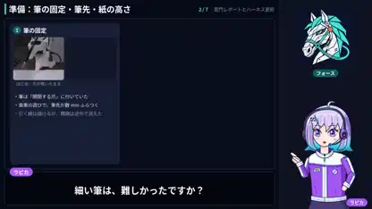

<!-- Generated by scripts/build.py. -->

# ロボットが雷門を描く工程の図解

[一覧に戻る](https://github.com/VibeClip/awesome-fable-5-2-videos/blob/main/README.ja.md)

**[▶ 本編](https://video.twimg.com/amplify_video/2121494558106439680/vid/avc1/1920x1080/DPZRyASdC9HYAryE.mp4?tag=29)** · [元の投稿](https://x.com/gclue_akira/status/2121494801506050378)

[gclue_akira](https://x.com/gclue_akira) · 2:06 · 2026-11-14

作者はFable 5.2とTazuna Robotics Harnessで雷門を描いた工程を解説。映像にはイラストの案内役と作業画面が登場します。 解説映像自体の描画方法は未公表です。

## 公開プロンプト

公開プロンプトは未登録です。

出典と確認情報

- モデル表記の根拠: 元の投稿にモデル名の記載あり
- 投稿のアクセス確認日: 2026-11-14 — 投稿にアクセス可能

投稿のアクセス確認と動画生成の再現は別です。生成やレンダリングを独立して再現していません。

[ライセンスとメディアの権利](https://github.com/VibeClip/awesome-fable-5-2-videos/blob/main/docs/MEDIA-RIGHTS.md)

