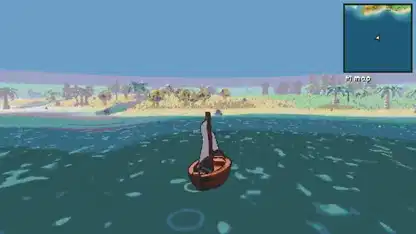

<!-- Generated by scripts/build.py. -->

# 戦闘モーションを追加した島のゲーム

[一覧に戻る](https://github.com/VibeClip/awesome-fable-5-2-videos/blob/main/README.ja.md)

**[▶ 本編](https://video.twimg.com/amplify_video/2120339686040158208/vid/avc1/1920x1080/-d4odGYaB3R0mUbK.mp4?tag=29)** · [元の投稿](https://x.com/hyphenholdings/status/2120340122461753345)

[hyphenholdings](https://x.com/hyphenholdings) · 1:05 · 2026-11-11

作者によると、この更新の回避やコンボなどの戦闘モーションをFable 5.2で制作。映像では水上から島への移動も見せており、返信から体験版を開けます。

[元の投稿](https://x.com/hyphenholdings/status/2120340296504643866)

## 公開プロンプト

公開プロンプトは未登録です。

出典と確認情報

- モデル表記の根拠: 元の投稿にモデル名の記載あり
- 投稿のアクセス確認日: 2026-11-15 — 投稿にアクセス可能

投稿のアクセス確認と動画生成の再現は別です。生成やレンダリングを独立して再現していません。

[ライセンスとメディアの権利](https://github.com/VibeClip/awesome-fable-5-2-videos/blob/main/docs/MEDIA-RIGHTS.md)

