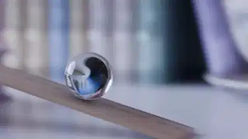

<!-- Generated by scripts/build.py. -->

# Blenderで作った小さなティールームのループ

[一覧に戻る](https://github.com/VibeClip/awesome-fable-5-2-videos/blob/main/README.ja.md)

**[▶ 本編](https://video.twimg.com/amplify_video/2120311299917873153/vid/avc1/1280x720/XX6AfZsYEyGyUmg8.mp4?tag=29)** · [元の投稿](https://x.com/ICO_AIvideo/status/2120311646933680355)

[ICO_AIvideo](https://x.com/ICO_AIvideo) · 0:22 · 2026-11-11

作者はFable 5.2とBlenderを使用。カメラが陶器と反射する球を通り過ぎ、ピンク色の部屋全体を見せます。

## 公開プロンプト

公開プロンプトは未登録です。

出典と確認情報

- モデル表記の根拠: 元の投稿にモデル名の記載あり
- 投稿のアクセス確認日: 2026-11-15 — 投稿にアクセス可能

投稿のアクセス確認と動画生成の再現は別です。生成やレンダリングを独立して再現していません。

[ライセンスとメディアの権利](https://github.com/VibeClip/awesome-fable-5-2-videos/blob/main/docs/MEDIA-RIGHTS.md)

