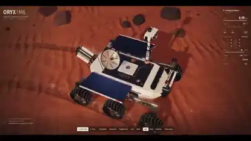

<!-- Generated by scripts/build.py. -->

# Three.jsで走る火星探査車

[一覧に戻る](https://github.com/VibeClip/awesome-fable-5-2-videos/blob/main/README.ja.md)

**[▶ 本編](https://video.twimg.com/amplify_video/2121298507961159680/vid/avc1/1280x720/nhXcrFt9DK3QepWN.mp4?tag=29)** · [元の投稿](https://x.com/ikowwy/status/2121298628556013995)

[ikowwy](https://x.com/ikowwy) · 1:40 · 2026-11-13

作者はFable 5.2と並列エージェントを使用し、外部の3Dモデルを読み込まずにThree.jsで走行可能な探査車を制作した。

## 公開プロンプト

公開プロンプトは未登録です。

出典と確認情報

- モデル表記の根拠: 元の投稿にモデル名の記載あり
- 投稿のアクセス確認日: 2026-11-16 — 投稿にアクセス可能

投稿のアクセス確認と動画生成の再現は別です。生成やレンダリングを独立して再現していません。

[ライセンスとメディアの権利](https://github.com/VibeClip/awesome-fable-5-2-videos/blob/main/docs/MEDIA-RIGHTS.md)

