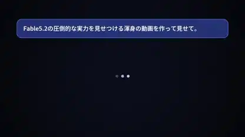

<!-- Generated by scripts/build.py. -->

# コードで描いたFableの自己紹介

[一覧に戻る](https://github.com/VibeClip/awesome-fable-5-2-videos/blob/main/README.ja.md)

**[▶ 本編](https://video.twimg.com/amplify_video/2120377027459182593/vid/avc1/1920x1080/RslvkhvTk3_XDi4c.mp4?tag=29)** · [元の投稿](https://x.com/jjjContinue/status/2120435611391909934)

[jjjContinue](https://x.com/jjjContinue) · 0:45 · 2026-11-11

作者はFable 5.2を使用。チャット画面風の導入から、発光する図形、カウンター、大きな日本語の文字演出へと移ります。

[元の投稿](https://x.com/jjjContinue/status/2120097601601372353)

## 公開プロンプト

公開プロンプトは未登録です。

出典と確認情報

- モデル表記の根拠: 元の投稿にモデル名の記載あり
- 投稿のアクセス確認日: 2026-11-14 — 投稿にアクセス可能

投稿のアクセス確認と動画生成の再現は別です。生成やレンダリングを独立して再現していません。

[ライセンスとメディアの権利](https://github.com/VibeClip/awesome-fable-5-2-videos/blob/main/docs/MEDIA-RIGHTS.md)

