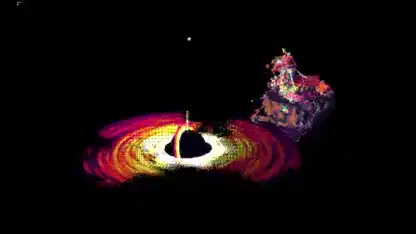

<!-- Generated by scripts/build.py. -->

# 塵に帰る

[一覧に戻る](https://github.com/VibeClip/awesome-fable-5-2-videos/blob/main/README.ja.md)

**[▶ 本編](https://video.twimg.com/amplify_video/2123938550148427777/vid/avc1/444x270/LilNc2fAICkT_HK4.mp4?tag=29)** · [元の投稿](https://x.com/JungleSilicon/status/2123938805254332825)

[JungleSilicon](https://x.com/JungleSilicon) · 0:41 · 2026-11-21

作者はFable 5.2を使用し、3Dピクセルアート風ガウシアンスプラットと説明している。

## 公開プロンプト

公開プロンプトは未登録です。

出典と確認情報

- モデル表記の根拠: 元の投稿にモデル名の記載あり
- 投稿のアクセス確認日: 2026-11-21 — 投稿にアクセス可能

投稿のアクセス確認と動画生成の再現は別です。生成やレンダリングを独立して再現していません。

[ライセンスとメディアの権利](https://github.com/VibeClip/awesome-fable-5-2-videos/blob/main/docs/MEDIA-RIGHTS.md)

